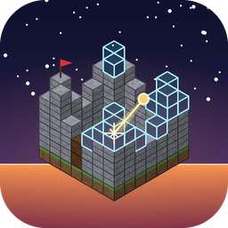

# Horizonmatica

A native mod for [Horizon](https://github.com/horizon-rust/horizon) (Minecraft Java Edition 26.3, rewritten in Rust):
show schematics as ghost blocks, check your build against them, get a material list, and let a **printer**
(auto-build) place the missing blocks. Horizonmatica is a re-creation of **Litematica** for Horizon.

> ## ❤️ Credits
>
> Horizonmatica wouldn't exist without these projects. The idea, the way it is used, the file format and the
> behaviour all come from them:
>
> - **[Litematica](https://github.com/maruohon/litematica)** by **masa** ([maruohon](https://github.com/maruohon)),
>   maintained for newer Minecraft versions by **[Sakura-Ryoko](https://github.com/sakura-ryoko/litematica)**.
>   The `.litematic` format, the overlay colours, the layer modes and the verifier follow Litematica.
> - **[Litematica Printer](https://github.com/aleksilassila/litematica-printer)** by **aleksilassila**
>   (Aleksi Lassila), maintained by Sakura-Ryoko. The printer follows its approach: the look is sent to the server
>   only with the click, the camera never moves.
> - **[Horizon](https://github.com/horizon-rust/horizon)** by the horizon-rust team: the game, the mod hooks, the
>   placement logic and the data fixer Horizonmatica uses. The table that maps old `.schematic` block ids
>   (`core/src/legacy_blocks.rs`) comes from Horizon's `block_state_data.txt`, which is generated from vanilla's
>   `BlockStateData` (Horizon is MIT licensed).
> - File formats: [Sponge Schematic](https://github.com/SpongePowered/Schematic-Specification) (`.schem`, WorldEdit),
>   MCEdit (`.schematic`), Mojang's structure files (`.nbt`).
>
> Horizonmatica is **not an official project** of these authors and is neither made nor endorsed by them. It contains
> no code from Litematica or the printer (licensed LGPL-3.0 and AGPL-3.0); only the file format and the behaviour
> are re-created. In game: `/horizonmatica credits` and the mod's menu.
>
> If you like Horizonmatica, go and support the originals.

| Feature | Status |
|---|---|
| Load `.litematic` (versions 1–7, several regions, negative sizes) | ✅ |
| Load `.schem` (Sponge v1–v3: WorldEdit, FAWE, Amulet, Axiom) | ✅ |
| Load `.nbt` (vanilla structure blocks, data packs) | ✅ |
| Load `.schematic` (MCEdit / WorldEdit up to 1.12, numeric block ids) | ✅ |
| Upgrade older files to the current version (Horizon's data fixer) | ✅ |
| Place, move, rotate (90/180/270), mirror (x/z) | ✅ |
| Several placements at once: select, show/hide, unload one or all | ✅ |
| Remembered per world and dimension, restored when you join again | ✅ |
| Ghost overlay: missing blocks as translucent real block models (chests and other block entities included) | ✅ |
| Overlay built per 16³ section: only what changed is rebuilt, within a time budget per tick; faces between ghost blocks are left out | ✅ |
| Verifier overlay: wrong block (red), wrong state (orange), extra block (pink) | ✅ |
| Layer modes: all / one layer / above / below / range | ✅ |
| Info HUD (progress in %, missing, wrong) | ✅ |
| Material list (HUD with item icons, menu, copy as a table for spreadsheets), missing vs. carried | ✅ |
| Own menu screen (M) drawn with the game's widgets | ✅ |
| **Printer**: places missing blocks within reach automatically, facing the right way | ✅ |
| **Easy place**: look at a ghost block to take its block in hand, hold right click to place it; nothing else can be placed while it is on | ✅ |
| Area selection and saving it as a `.litematic` (blocks and their states) | ✅ |
| Saving block entity data (chest contents, sign texts) and entities, several regions, Easy Place protocol | ❌ (not yet) |

## Installation

Native mods are compiled into the game by the Horizon launcher. They run unsandboxed, so only you can approve
building them.

1. Install the **Horizon launcher** and start the game once.
2. Build the mod into your instance, either from this folder:

   ```
   horizon-launcher native-build <path to this repository>/mixins --trust-native-code
   ```

   or in the launcher: **Mods** → install a native mod from a folder (or a `.hnmod` file) → **Build**.
   The first build downloads Rust and takes 20–30 minutes; later builds are faster.
3. To get a package: `python tools/package.py` writes `dist/horizonmatica-0.3.0.hnmod`.

**Version:** the mod uses game internals (block models, placement prediction, the data fixer, the Debug Options
screen for its menu), so it is pinned to one Horizon commit: `horizon_revision` in
`mixins/horizonmatica/horizon-mixin.toml`, currently **Nightly 2026-11-04 (`67dad0d`, hook API 359)**, which it is
checked against. It needs the render hooks `world_drawn`/`render_needs` (API 58+). For another Nightly, set its
commit (`python tools/package.py --horizon <commit>`) and build again.

### Verifying downloads

Every release `.hnmod` is signed with [minisign](https://jedisct1.github.io/minisign/); the signature is the
`.minisig` asset next to it. The public key is [`minisign.pub`](minisign.pub):

```
RWS+BRoCJslNCFapck3cbG2VFQcjlr1MUH5m3+CWA8zhJecoBoja7X94
```

Check a download with:

```
minisign -Vm horizonmatica-0.3.0.hnmod -P RWS+BRoCJslNCFapck3cbG2VFQcjlr1MUH5m3+CWA8zhJecoBoja7X94
```

## Usage

The [wiki](https://github.com/keksi2k/horizonmatica/wiki) explains every button of the menu, tab by tab, with the matching command.

Schematics go into the `schematics/` folder next to `options.txt` of your Horizon instance
(`/horizonmatica folder` shows the path). `.litematic`, `.schem`, `.schematic` and `.nbt` files are read; the mod
tells the format by the contents. When two files share a name, loading without an extension picks the `.litematic`.

- **Older files** (from 1.16 or 1.12, say) go through Horizon's data fixer when loaded, like old worlds do:
  `grass` becomes `short_grass`, `grass_path` becomes `dirt_path`, `sign` becomes `oak_sign`, and so on.
- **`.nbt`:** cells the structure file doesn't list count as structure void and are neither checked nor built.
- **`.schematic` (old):** numeric ids are mapped with vanilla's flattening table. What the old format kept elsewhere
  is worked out again: door halves, tall plants, skull and bed colours, banner colours, double chests, snowy grass.
  Flower pot contents are lost (an empty pot).
- Fence, pane, wall and redstone connections and stair shapes follow from the neighbours while building, so they
  don't count as wrong unless **strict states** are on.
- **Large files** load too: a region may hold up to 2,147,483,648 blocks (2³¹, the same bound as saving). Files are
  read by a thread of their own, so the game goes on meanwhile (the HUD shows "Loading ..."); the overlay is built
  only around you (the render radius). Memory is the real limit: the blocks take a few bits each (a 1000 × 384 ×
  1000 area with a few hundred kinds of block is about 400 MB), about twice that while the file is read.

| Command | Effect |
|---|---|
| `/horizonmatica list` | List the schematics in the folder |
| `/horizonmatica load <name>` | Load one as another placement at your position and select it (the name without extension, or its start, is enough) |
| `/horizonmatica reload` | Read the last schematic again from its file, where it was |
| `/horizonmatica placements` | List the placements (`>` marks the selected one) |
| `/horizonmatica select <n>\|<name>\|next\|prev` | Select a placement: the commands below, move mode, the HUD and the material list are about the selected one |
| `/horizonmatica show [on\|off]` · `hide` | Show or hide the selected placement (hidden ones stay loaded, but aren't drawn or printed) |
| `/horizonmatica lock [on\|off]` · `unlock` | Lock the selected placement where it is (no moving, turning or mirroring) |
| `/horizonmatica unload [<n>\|all]` | Unload the selected placement, another one, or all (and forget them for this world) |
| `/horizonmatica origin here` · `origin <x> <y> <z>` · `move <dx> <dy> <dz>` | Move it |
| `/horizonmatica rotate cw\|ccw\|180\|none` · `mirror none\|x\|z` | Rotate / mirror it |
| `/horizonmatica highlight missing\|wrong [on\|off]` · `item <item>\|all` · `off` | Mark missing or wrong blocks through everything, optionally of one item |
| `/horizonmatica pos1` · `pos2` (· `here` · `<x> <y> <z>`) | Set a corner of the area selection: the block you look at, where you stand, or a position |
| `/horizonmatica tool` `on` · `off` · `<item>` · `mode area\|placement` | The selection tool (default: a stick), and whether it works on the area or the placements |
| `/horizonmatica area` · `area clear` | Show / clear the area selection |
| `/horizonmatica save <name> [overwrite]` · `save status` · `save cancel` | Save the area as `<name>.litematic` in the schematics folder (chunk by chunk), see how far it is, or stop it |
| `/horizonmatica layer all\|<y>\|here\|up\|down\|above <y>\|below <y>\|range <a> <b>` | Layers |
| `/horizonmatica render on\|off` · `through on\|off` · `mode ghost\|boxes` | Display (`through`: see through blocks) |
| `/horizonmatica radius <blocks>\|view` · `faces <n>\|none` · `fluids on\|off` | How far the overlay reaches (`view`: as far as you see), the most faces it keeps (`300k`, `2m`, `none`), water and lava shown or hidden |
| `/horizonmatica info` | Position, progress, errors |
| `/horizonmatica materials [on\|off]` · `materials copy` | The material list in the HUD on or off; copy it to the clipboard as a table for a spreadsheet |
| `/horizonmatica printer on\|off` · `air on\|off` · `speed <ticks>` · `reach <blocks>` | Printer |
| `/horizonmatica easyplace on\|off` · `every <ticks>` · `air on\|off` | Easy place |
| `/horizonmatica credits` | Who made the originals |

`/hm` is the short form. The chat completes the commands: type `/hm ` and it offers the subcommands and their
options as you type, with your schematic files after `load` and your placements after `select` and `unload`.

**How far you see the schematic:** the overlay is built around you, nearest first: within the render radius
(32 blocks by default; the menu goes to 1024, `/hm radius <blocks>` any further) or, with `/hm radius view`, as far
as your view distance. Every face costs about 180 bytes of video memory, and the face limit (300k by default, about
50 MB) stops it from taking more: a large build at full view distance can need several million faces, so it is up to
you what the memory is worth (`/hm faces 2m`, `/hm faces none`). The Display tab shows how many faces the overlay
holds and what they take. Only the sections in front of you are drawn. Water and lava are whole cubes as ghosts;
`/hm fluids off` (or the Display tab) hides them.

**Several placements:** every `load` adds a placement; all shown ones are drawn and printed at once. Where two
overlap, the later one's blocks win (its air doesn't erase the other's blocks). The verifier's HUD line and the
material list are the selected placement's.

**Remembered per world:** for every world (single player: its folder; servers: their address) and every dimension,
Horizonmatica remembers which schematics are placed where, rotated and mirrored how, and which are hidden. When you
join the world again they are loaded at the same spots (with a line in chat). Switching to another world or
dimension unloads them and loads the ones remembered there. `/hm unload` forgets one for the world, `/hm unload all`
every one.

**Saving your own schematics:** set two opposite corners with the **selection tool** (a stick, as in Litematica), with
`/hm pos1` and `/hm pos2` (the block you look at, up to 64 blocks away) or in the menu's **Save** tab. The box shows as a white frame, corner 1 red and corner 2 blue (as in
Litematica). `/hm save <name>` writes `<name>.litematic` (Litematica's format, version 7) into the schematics
folder: every block with its state. As in Litematica, the area is read chunk by chunk, a few per tick, so the game
doesn't stall, and each chunk is read when it is loaded. Chunks that aren't loaded show as orange frames, and the
HUD (and the Save tab) tells how many are left and where the nearest is: fly there and the save goes on; the file is
written when the last chunk is in (by a thread of its own, so large files don't stall the game either). `/hm save
cancel` stops it. The file stores air like Litematica does (the format has a cell for every position), but it costs
next to nothing: a few bits per block, and gzip packs the runs of air away; sections of nothing but air aren't even
read. Not saved: block entity data (chest contents, sign texts, banner patterns) and entities, which the client
doesn't keep in one place. The area isn't remembered.

With the selection tool in your main hand (area mode, the default):

| Input | Effect |
|---|---|
| Left click | Corner 1 on the block you look at (up to 128 blocks by default; nothing is broken) |
| Right click | Corner 2 on the block you look at |
| Middle click | Pick the corner you look at; again, or elsewhere: the whole box |
| Alt + wheel | Move the picked corner (or the whole box) along the direction you look |
| Ctrl + wheel | Grow (up) or shrink (down) the box on the side you look at |
| Shift | 5 blocks per wheel step instead of 1 |
| Ctrl + middle click | Switch to placement mode (and back) |

In **placement mode** (Ctrl + middle click, `/hm tool mode placement`, or the Tool or Placement tab) the tool works on
the loaded placements instead:

| Input | Effect |
|---|---|
| Left (or middle) click | Select the placement you look at (its box) |
| Right click | Move the selected placement's origin to the block you look at |
| Alt + wheel | Move it along the direction you look (Shift: 5 blocks) |
| Ctrl + wheel | Turn it (up: clockwise) |

A **locked** placement (`/hm lock`, or Lock in the Placement tab) can't be moved, turned or mirrored, neither by the
tool nor by commands, move mode or the menu; `/hm unlock` frees it. The lock is remembered with the world. Every
shown placement has a faint frame around its box, the selected one a bright one: cyan, or orange when it is locked
(**Boxes around placements** in the Display tab turns them off).

Set it up in the menu's **Tool** tab: which item, its reach (up to 256 blocks), whether a click marks the block hit or
the one in front of it (handy for selecting the air above a floor), and whether water and lava stop it (off: it
goes through to the ground). `/hm tool off` turns it off, `/hm tool <item>` takes another item.

Keys (the defaults; any action can be bound on the menu's **Keys** tab):

| Key | Action |
|---|---|
| M | **Open the menu** (as in Litematica) |
| V | Rendering on/off |
| Page Up / Page Down | Layer up / down |
| Home | Next layer mode (all → this layer → above → below) |
| K | Printer on/off |
| J | Material list in the HUD on/off |
| N | Move mode on/off |

**Move mode (N):** only in this mode do the mouse and keys move the schematic; while it is off, only commands and
the menu do, so nothing gets moved by accident. In move mode:

| Input | Effect |
|---|---|
| Mouse wheel | Along your view (the closest axis, up and down too) |
| Arrow keys | Forward / back / left / right relative to your view |
| Page Up / Page Down | Up / down (instead of changing layers) |
| R | Rotate clockwise |
| Home | Move it to your position |
| Shift held | 5 blocks instead of 1 |
| N or Enter | Done, the schematic is locked again |

The printer pauses while move mode is on.

### The menu (M)

**M** opens Horizonmatica's own screen, drawn with the game's widgets (buttons, sliders, edit boxes, scroll lists,
tooltips, item icons) by [horizon-menus](libs/horizon-menus/README.md). The game keeps running behind it. **Esc**,
**M** or **Done** close it, **1–8** switch tabs, the **Credits** button at the top left shows who made the originals.

| Tab | Contents |
|---|---|
| Load | Search box, scrolling file list with sizes, details of the picked file (size, blocks, format, author), load as another placement (or click the file twice), reload the last one, open the folder |
| Placement | All placements as a list (click one to select it); next to it the selected one: progress, show or hide, lock, unload, the origin as edit boxes, nudge buttons ±X/±Y/±Z (Shift: 10 blocks), move to me, move mode, rotate, mirror, layers, the tool's mode; easy place on/off |
| Save | The area selection's corners as edit boxes (or the block you look at, or where you stand), its size, a name, save (a second click overwrites an existing file) |
| Tool | The selection tool: on/off, which item (pick one of eight with their icons, type an id, or take the one in your hand), its reach, whether a click marks the block hit or the one in front of it, whether water and lava stop it, its controls in the HUD |
| Printer | On/off, blocks placed, speed and reach as sliders, air place |
| Display | Overlay and HUD settings (opacity, render radius or view distance, face limit, water and lava), and what the overlay holds right now |
| Materials | Material list with item icons: missing, total, carried; copy it for a spreadsheet; the HUD list on/off |
| Keys | Every action with its key: click one and press the new key, or reset them all |

When the screen can't open (over another screen, say), M opens the mod's page in **Options › Mods** instead, with the
same settings as buttons (Shift + click steps backwards).

Under the hood the screen borrows the place of the Debug Options screen (F3+F6): its draw and input functions are
hooked and do nothing of their own while the game hasn't opened that screen itself, and the game doesn't pause for it.

### Printer (auto-build)

While the printer is on, it places one missing block within reach every few ticks, from the bottom up and only in
the layers shown. For each block it tries click points on the neighbouring faces and asks Horizon's own placement
logic (`placement_state`, vanilla's `getStateForPlacement`) what that click would place. It only clicks when exactly
the wanted state comes out (stairs the right way round, top/bottom slabs, furnaces, logs...).

- **Survival:** the item has to be in the hotbar. If it is only in the inventory, the HUD says so.
- **Creative:** only the hotbar is used: a free slot, else one whose item the schematic doesn't need any more, else
  the one used longest ago. The rest of the inventory stays as it is.
- **Redstone order:** plain blocks first, then what carries or uses a signal (dust, repeaters, comparators, pistons,
  droppers, lamps, doors...), then what makes one (torches, levers, buttons, redstone blocks...), observers last and
  only once the block they watch is there, so they don't fire while you build.
- **Set up after placing:** repeater delay, comparator mode, daylight detector inversion and note block pitch are
  clicked to the right value after placing.
- **On/off states** (powered, lit, power...) don't stop it: the block is placed, and if its state is wrong the
  overlay shows it as a wrong state (can be turned off: Display › "Redstone on/off counts as wrong").
- **Falling blocks** (sand, gravel, concrete powder, anvils, the dragon egg) are only placed onto something: if the
  block below is still missing it waits; if they float in the schematic it leaves them out (the HUD says why).
- **Item changes:** through a server (also the integrated server of a single-player world) it clicks only in the
  tick after a slot or item change, so the server doesn't place the item held before.
- **Double slabs and stacks:** where half a slab is already there, it clicks it into a double slab; likewise more
  candles, sea pickles, snow layers, turtle eggs, petals.
- **Chests:** a double chest forms when its second half is placed; a single chest next to one facing the same way is
  placed sneaking so that it stays single (in your own world). Ghost chests (and shulker boxes, banners, heads,
  bells) show their real model.
- The camera never moves (as with litematica-printer). In your own world the click is used within the same tick; on
  servers only the server is told the right look for the click.
- **Air place** (`/hm printer air on|off`, off by default): when no neighbour can be clicked, it clicks the empty spot
  itself, which vanilla servers allow. It checks first that the result faces the right way. Anti-cheat plugins
  (Grim, say) notice this.
- **Without air place,** only blocks next to a real block whose face you can see are tried; the rest are passed over
  at once and the HUD counts them. With it, blocks with such a neighbour still come first.
- Blocks that can't be placed as wanted from where you stand aren't tried again until you move or a neighbour changes.
- Logs, froglights and other pillars take their direction from the clicked face alone: without air place they need a
  real block on the matching side, with that face in view.
- Plants are placed by the item that grows them and count as correct at any stage of growth.
- Fluids are not placed. Blocks that can't be placed right from any reachable side are skipped; the HUD says why.
- ⚠️ On other people's servers, automatic placing may break the rules or trip anti-cheat.

## Layout

```
mixins/horizonmatica/          the bundle Horizon builds in
  horizon-mixin.toml           hooks (tick, frame, hud, key, wheel, command(s), mods, settings, world_drawn,
                               render_needs) and the menu screen's injections
  *.rs                         thin helpers, one per hook
  runtime.rs                   game side: commands, HUD, verifier scan, overlay geometry, printer, menu screen
  bridge.rs                    render side (in horizon-client-render): the overlay's own GPU pass
  core/                        a crate of its own without the game, with unit tests: NBT, file formats, bit
                               arrays, rotation/mirroring, verifier, material list, printer planning
  menus/, menus_*.rs           copy of horizon-menus with its screen hooks (don't edit: vendor_menus.py)
libs/horizon-menus/            the menu library (git submodule: github.com/keksi2k/horizon-menus)
tools/make_icon.py             renders icon.png
tools/package.py               packs the .hnmod (and checks the horizon-menus copy is current);
                               --sign also signs it with minisign (asks for the key's password)
docs/wiki/                     the wiki: every tab, button and command
minisign.pub                   the public key release files are signed with
horizon-registry.toml          the project's page in the Horizon mod registry (read from the newest release's tag)
```

Clone with `git clone --recursive`, or run `git submodule update --init` afterwards. After updating the library:
`python libs/horizon-menus/tools/vendor_menus.py mixins/horizonmatica horizonmatica`.

Tests: `cargo test -p horizonmatica-core -p horizon-menus`. A test schematic:
`cargo run -p horizonmatica-core --example sample -- sample_hut.litematic`.

License: MIT. No code taken from Litematica; the file format and the behaviour are re-created.
